# PLESK - Entorno de Explotación
**MOISÉS ALBERTO DOMÍNGUEZ CRUZ**
**IES LOS SAUCES - DAW2** (2026/2027)

*(Publicación de los proyectos en el servidor de explotación con Plesk)*

---

## Índice
- [PLESK - Entorno de Explotación](#plesk---entorno-de-explotación)
  - [Índice](#índice)
  - [1. Plesk](#1-plesk)
    - [1.1. Panel general](#11-panel-general)
    - [1.2. Configuración de hosting](#12-configuración-de-hosting)
  - [2. Conexión por SFTP con MobaXterm](#2-conexión-por-sftp-con-mobaxterm)
    - [2.1. Cuenta FTP](#21-cuenta-ftp)
    - [2.2. Sesión SFTP en MobaXterm](#22-sesión-sftp-en-mobaxterm)
  - [3. Estructura del servidor](#3-estructura-del-servidor)
  - [4. Creación de los subdominios](#4-creación-de-los-subdominios)
  - [5. Publicar una versión estable de GitHub](#5-publicar-una-versión-estable-de-github)
    - [5.1. Tag y release](#51-tag-y-release)
    - [5.2. Subida al servidor](#52-subida-al-servidor)
    - [5.3. Versiones publicadas](#53-versiones-publicadas)
  - [6. Bases de datos](#6-bases-de-datos)
    - [6.1. Crear la base de datos y su usuario](#61-crear-la-base-de-datos-y-su-usuario)
    - [6.2. Importar el script de explotación](#62-importar-el-script-de-explotación)
    - [6.3. Archivo de configuración de explotación](#63-archivo-de-configuración-de-explotación)
  - [7. Fichero .htaccess](#7-fichero-htaccess)
    - [7.1. Índice, listado de carpetas y páginas de error](#71-índice-listado-de-carpetas-y-páginas-de-error)
    - [7.2. Autenticación HTTP con PHP-FPM (Tema 5)](#72-autenticación-http-con-php-fpm-tema-5)
  - [8. Comprobaciones](#8-comprobaciones)

---

## 1. Plesk

Plesk es el panel de control del servidor de explotación. Cada alumno tiene su propio subdominio:

- **Subdominio:** `https://moisesadomcru.ieslossauces.es/`
- **Usuario del sistema:** `moisesadomcru`
- **Carpeta del sitio web:** `httpdocs`

### 1.1. Panel general

Desde **Sitios web y dominios** se ve el dominio principal y sus herramientas: archivos, bases de datos, FTP, PHP, certificados SSL, etc.

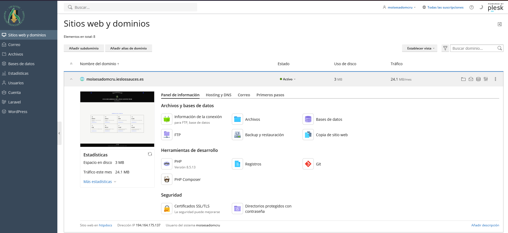

### 1.2. Configuración de hosting

En **Hosting y DNS > Configuración de hosting** se comprueba:

- **Scripting web:** PHP se ejecuta con **FastCGI** (PHP-FPM), no como módulo de Apache. Esto es importante para la autenticación HTTP del Tema 5 (ver [7.2](#72-autenticación-http-con-php-fpm-tema-5)).
- **Documentos de error personalizados:** activado, para que funcionen las páginas 404 y 403 de cada proyecto.
- **Acceso SSH:** `/bin/bash`, necesario para conectarse por SFTP.

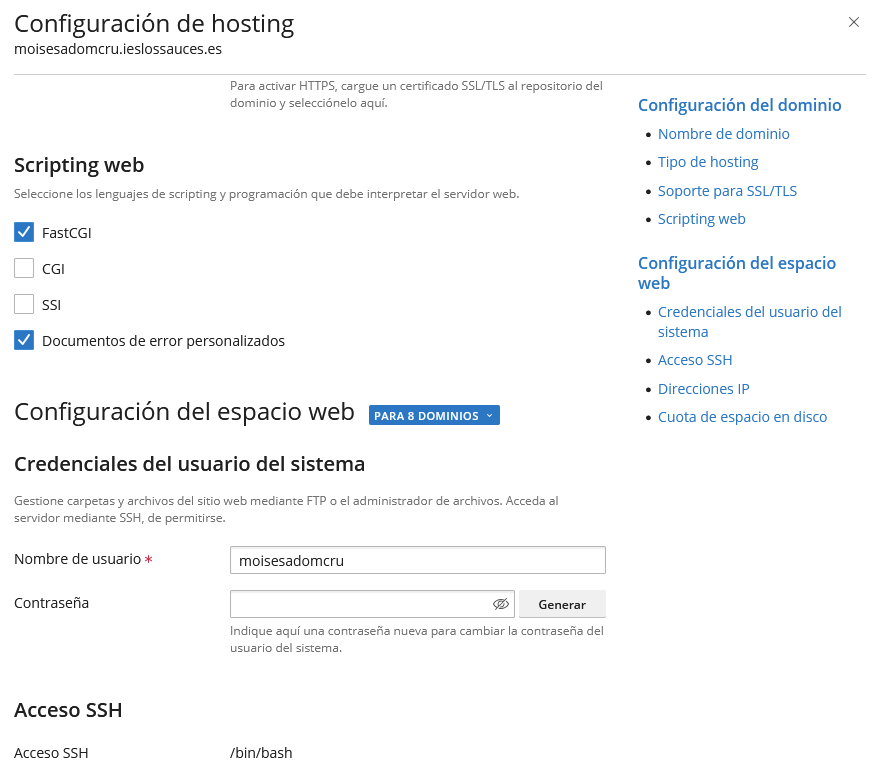

---

## 2. Conexión por SFTP con MobaXterm

### 2.1. Cuenta FTP

En **Sitios web y dominios > FTP** está la cuenta `moisesadomcru`, cuyo inicio es la raíz del espacio web (`/`).

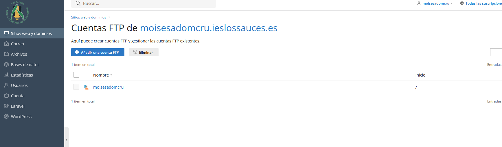

### 2.2. Sesión SFTP en MobaXterm

En MobaXterm se crea una sesión **SFTP** con estos datos:

| Campo | Valor |
|-------|-------|
| Remote host | `moisesadomcru.ieslossauces.es` |
| Username | `moisesadomcru` |
| Port | `22` |

Al conectar se entra en `/var/www/vhosts/moisesadomcru.ieslossauces.es/`. Los archivos de la web van dentro de `httpdocs/`.

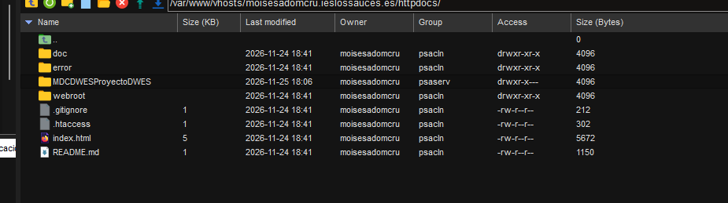

---

## 3. Estructura del servidor

El portfolio va en la raíz de `httpdocs` y cada proyecto en su propia carpeta, con el mismo nombre que su repositorio de GitHub:

```
httpdocs/
├── index.html                          → Portfolio (MDCProyectoDAW)
├── error/                              → Páginas 404 y 403 del portfolio
├── webroot/                            → Estilos, scripts e imágenes comunes
├── .htaccess
├── MDCDWESProyectoDWES/
├── MDCDWESProyectoTema3/
├── MDCDWESProyectoTema4/
├── MDCDWESProyectoTema5/
├── MDCDWESProyectoLoginLogoffTema5/
├── MDCCIBProyectoCIB/
└── MDCDAWProyectoDAW/
```

El nombre de la carpeta tiene que ser exactamente el del repositorio, porque el `.htaccess` de cada proyecto apunta a sus páginas de error con esa ruta (ver [7.1](#71-índice-listado-de-carpetas-y-páginas-de-error)).

---

## 4. Creación de los subdominios

Cada proyecto tiene además su propio subdominio, por ejemplo `MDCDWESProyectoTema4.moisesadomcru.ieslossauces.es`. Se pueden crear hasta 20.

1. En **Sitios web y dominios** se pulsa **Añadir subdominio**.

   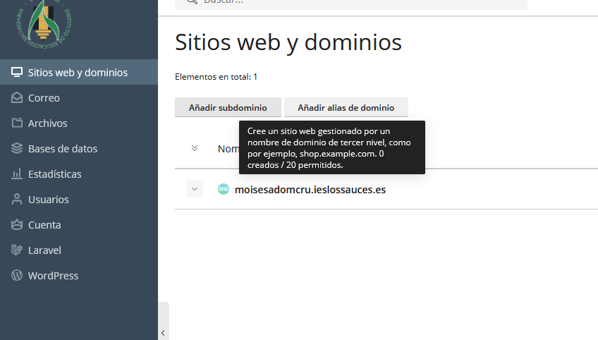

2. Se escribe el nombre del subdominio (el del proyecto) y en **Raíz del documento** la carpeta del proyecto dentro de `httpdocs`. Se pulsa **Aceptar**.

   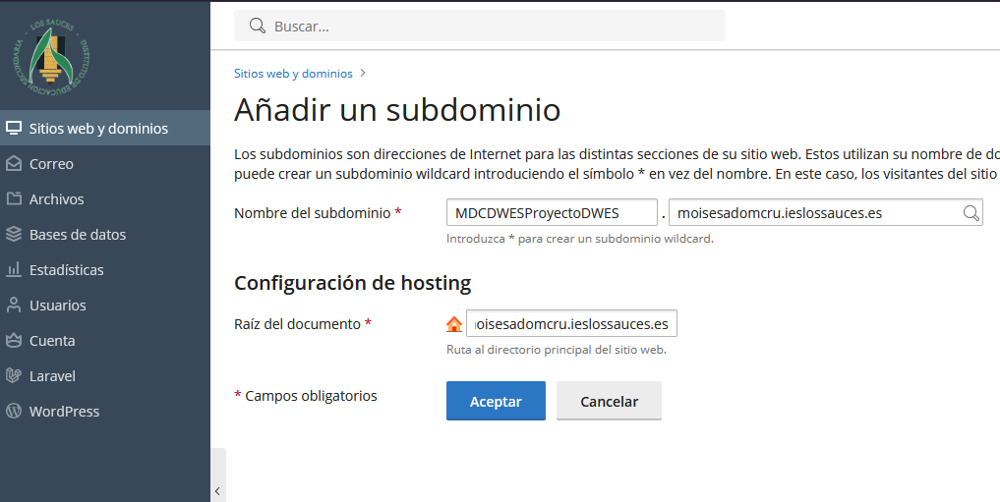

3. El subdominio aparece en la lista con su propio panel, desde el que se gestionan sus archivos y su base de datos.

   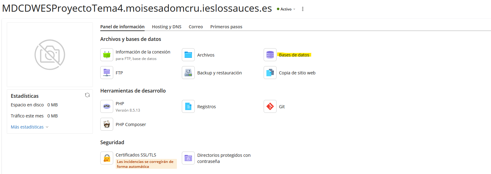

---

## 5. Publicar una versión estable de GitHub

### 5.1. Tag y release

Antes de publicar, en GitHub las ramas `master` y `developerMDC` tienen que apuntar al mismo commit. Después:

1. Se crea un **tag** con la versión sobre `master`. Formato de la versión: `1.0.0` (sin "v").
2. Se crea la **release** a partir de ese tag, con el título de la versión y una descripción:

   ```
   # NombreDelRepositorio

   Descripción breve del proyecto.
   ```

### 5.2. Subida al servidor

1. Se descarga el ZIP de la release o se usa la carpeta local del proyecto (que está en el mismo commit que el tag).
2. Si el proyecto tiene base de datos, se cambia el `require_once` de los ejercicios al archivo de configuración de explotación (ver [6.3](#63-archivo-de-configuración-de-explotación)).
3. Con MobaXterm se sube la carpeta a `httpdocs/NombreDelRepositorio/`. **No** se suben las carpetas `.git` ni `nbproject`.

### 5.3. Versiones publicadas

| Proyecto | Versión | Base de datos |
|----------|:-------:|:-------------:|
| MDCProyectoDAW (portfolio) | 1.1.0 | No |
| MDCDWESProyectoDWES | 1.0.1 | No |
| MDCDWESProyectoTema3 | 1.0.1 | No |
| MDCDWESProyectoTema4 | 1.0.1 | Sí |
| MDCDWESProyectoTema5 | 1.0.1 | Sí |
| MDCDWESProyectoLoginLogoffTema5 | 1.0.1 | Sí |
| MDCCIBProyectoCIB | 1.0.1 | No |
| MDCDAWProyectoDAW | 1.0.1 | No |

---

## 6. Bases de datos

En Plesk no hay permisos para `CREATE DATABASE`, `CREATE USER` ni `GRANT`. La base de datos y su usuario se crean desde el panel, y luego se importa un script que solo crea las tablas y hace la carga inicial.

Cada proyecto con base de datos tiene su script de explotación:

| Proyecto | Script |
|----------|--------|
| Tema 4 | `scriptsDB/CreaBDMDCProyectoTema4Explotacion.sql` |
| Tema 5 | `scriptsDB/CreaDBMDCDWESProyectoTema5Explotacion.sql` |
| LoginLogoff | `scriptDB/CreaDBMDCDWESProyectoLoginLogoffTema5Explotacion.sql` |

### 6.1. Crear la base de datos y su usuario

1. En el panel del subdominio se entra en **Bases de datos** y se pulsa **Añadir base de datos**.

   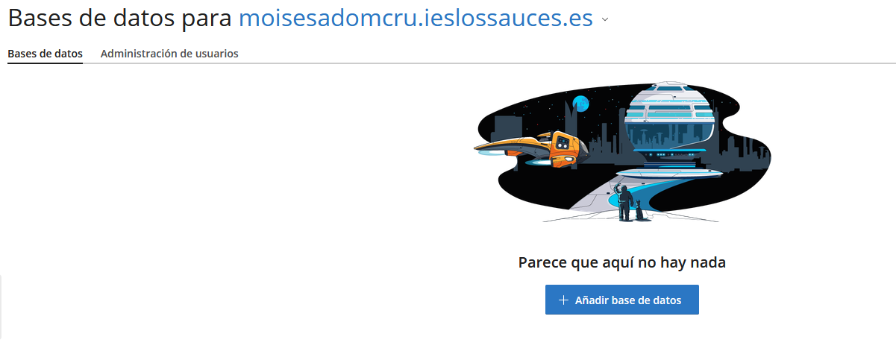

2. Se rellena el formulario:
   - **Nombre de la base de datos:** el mismo que en desarrollo, por ejemplo `DBMDCDWESProyectoTema4`.
   - **Servidor de bases de datos:** `localhost:3306` (MariaDB).
   - **Sitio relacionado:** el subdominio del proyecto.
   - **Crear un usuario de la base de datos:** activado, con el mismo usuario que en desarrollo (`userMDCDWESProyectoTema4`) y una contraseña.

   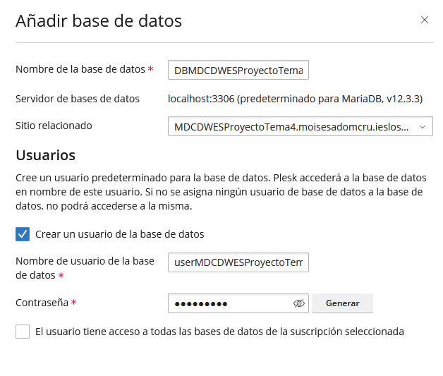

3. La base de datos aparece creada, todavía sin tablas, con sus herramientas: phpMyAdmin, importar volcado, información de la conexión, etc.

   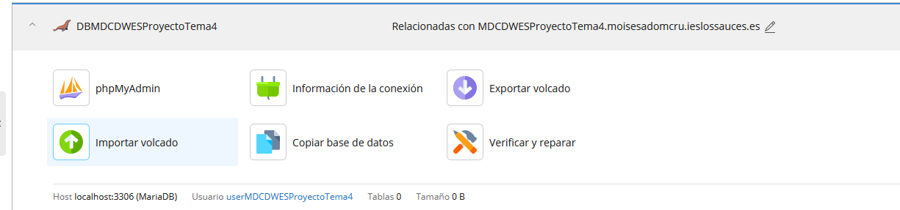

### 6.2. Importar el script de explotación

1. Se pulsa **Importar volcado**.
2. Se elige **Cargar un volcado desde el ordenador local** y se selecciona el script de explotación del proyecto.
3. Con **Recrear la base de datos** marcado, la base de datos se vacía antes de importar. Así el script se puede volver a ejecutar sin que den error las claves repetidas.

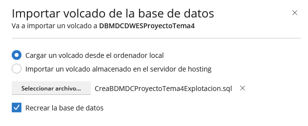

También se puede hacer desde **phpMyAdmin**, pestaña **SQL**, con la base de datos seleccionada.

### 6.3. Archivo de configuración de explotación

Cada proyecto con base de datos tiene en `config/` un archivo de explotación con los datos de Plesk. El servidor es `localhost` porque la base de datos está en el mismo servidor que la web:

```php
define('HOST', "mysql:host=localhost;dbname=DBMDCDWESProyectoTema4;charset=utf8mb4");
define('USER', "userMDCDWESProyectoTema4");
define('PASS', "contraseña puesta en Plesk");
```

Al subir la versión hay que cambiar el `require_once` de los ejercicios para que carguen este archivo:

| Proyecto | Archivos | Cambio |
|----------|----------|--------|
| Tema 4 | `ejercicio01MYSQli.php` | `configDBMYSQLi.php` → `configDBMYSQLiExplotacion.php` |
| Tema 4 | `ejercicio01PDO` a `ejercicio08_01PDO` (10 archivos) | `configDBPDO.php` → `configDBPDOExplotacion.php` |
| Tema 5 | `ejercicio02PDO.php` | `configDBPDO.php` → `configDBPDOExplotacion.php` |
| LoginLogoff | `login.php`, `registro.php`, `editarPerfil.php`, `cambiarPassword.php` | `configDBPDOClase.php` → `configDBPDOExplotacion.php` |

---

## 7. Fichero .htaccess

### 7.1. Índice, listado de carpetas y páginas de error

Cada proyecto tiene su `.htaccess` en la raíz de su carpeta. Ejemplo del Tema 4:

```apache
# Indice de esta carpeta de proyecto (estandar de proyecto por asignatura).
DirectoryIndex indexProyectoTema4.php

# Si se entra en una carpeta sin indice no se muestra el listado de archivos: da un error 403.
Options -Indexes

# Control de errores con las paginas de este proyecto (carpeta error/)
ErrorDocument 404 /MDCDWESProyectoTema4/error/404.html
ErrorDocument 403 /MDCDWESProyectoTema4/error/403.html
```

- **DirectoryIndex:** la página que se abre al entrar en la carpeta del proyecto.
- **Options -Indexes:** si se entra en una carpeta sin índice (por ejemplo `webroot/`), no se ve la lista de archivos, sino un error 403.
- **ErrorDocument:** cada proyecto tiene sus propias páginas `error/404.html` y `error/403.html`, con el CSS dentro de la página y sin imágenes, para que funcionen aunque el proyecto se despliegue solo. La ruta tiene que ser desde la raíz del servidor, por eso lleva el nombre de la carpeta del proyecto.

El portfolio, en la raíz de `httpdocs`, usa sus propias páginas:

```apache
Options -Indexes

ErrorDocument 404 /error/404.html
ErrorDocument 403 /error/403.html
```

### 7.2. Autenticación HTTP con PHP-FPM (Tema 5)

Los ejercicios 1 y 2 del Tema 5 usan la autenticación HTTP con `header('WWW-Authenticate: Basic ...')` y leen el usuario y la contraseña de `$_SERVER['PHP_AUTH_USER']` y `$_SERVER['PHP_AUTH_PW']`.

En Plesk PHP funciona con FastCGI (PHP-FPM) y Apache no le pasa la cabecera `Authorization`. Esas variables llegan vacías y el navegador pide el usuario y la contraseña una y otra vez, aunque sean correctos. Se soluciona añadiendo esta línea al `.htaccess` del Tema 5:

```apache
# PHP funciona con FastCGI (PHP-FPM): se le pasa la cabecera Authorization
# para que $_SERVER['PHP_AUTH_USER'] y $_SERVER['PHP_AUTH_PW'] tengan valor
SetEnvIf Authorization "(.*)" HTTP_AUTHORIZATION=$1
```

---

## 8. Comprobaciones

Después de subir cada proyecto se comprueba:

| Comprobación | Ejemplo | Resultado esperado |
|--------------|---------|--------------------|
| Índice del proyecto | `/MDCDWESProyectoTema4/` | Se abre `indexProyectoTema4.php` |
| Error 404 | `/MDCDWESProyectoTema4/noexiste` | Página 404 del proyecto |
| Error 403 | `/MDCDWESProyectoTema4/webroot/` | Página 403 del proyecto |
| Base de datos | Ejercicio 2 del Tema 4 | Se muestra la tabla de departamentos |
| Autenticación HTTP | Ejercicio 2 del Tema 5 con `moises` / `paso` | Entra al panel de control |
| Login | LoginLogoff con `moises` / `paso` | Entra al inicio privado |

Si alguna página da un **error 500**, se revisa el `.htaccess`: Apache no admite alguna de sus directivas en ese servidor.

Autor: Moises Dominguez Cruz