# W11ED - Cliente de Desarrollo
**MOISÉS ALBERTO DOMÍNGUEZ CRUZ**
**IES LOS SAUCES - DAW2** (2026/2027)

## Índice
- [W11ED - Cliente de Desarrollo](#w11ed---cliente-de-desarrollo)
  - [Índice](#índice)
  - [1. Configuración de la máquina](#1-configuración-de-la-máquina)
  - [2. Cuentas administradoras y cuenta de desarrollador](#2-cuentas-administradoras-y-cuenta-de-desarrollador)
  - [3. Navegadores](#3-navegadores)
  - [4. MobaXterm](#4-mobaxterm)
      - [Instalación](#instalación)
      - [4.1 Crear una sessión SSH](#41-crear-una-sessión-ssh)
      - [4.2 Crear una sessión SFTP](#42-crear-una-sessión-sftp)
  - [5. NetBeans](#5-netbeans)
    - [5.1 Instalación y configuración inicial. Plugings.](#51-instalación-y-configuración-inicial-plugings)
    - [5.2 Creación de proyectos, modificación, borrado, prueba.](#52-creación-de-proyectos-modificación-borrado-prueba)
    - [5.3 Administración de la base de datos](#53-administración-de-la-base-de-datos)
    - [5.4 Conexión al repositorio y versionado (Git)](#54-conexión-al-repositorio-y-versionado-git)
    - [5.5 Depuración (Configuración de la ejecución para la depuración)](#55-depuración-configuración-de-la-ejecución-para-la-depuración)
    - [Configuraciones Adicionales y Herramientas del IDE pendientes](#configuraciones-adicionales-y-herramientas-del-ide-pendientes)
---

## 1. Configuración de la máquina

El sistema operativo utilizado es Windows 10 Pro.

**Especificaciones de Windows:**
* **Edición**: Windows 10 Pro
* **Versión**: 22H2
* **Instalado el**: 08/09/2025
* **Experiencia**: Windows Feature Experience Pack 1000.19062.1000.0

**Especificaciones del dispositivo (supervisado por un dominio):**
* **Nombre del dispositivo**: ED49000391P391
* **Nombre completo del dispositivo**: ED49000391P391.educa.jcyl.es
* **Procesador**: Intel(R) Core(TM) i5-7400 CPU @ 3.00GHz 3.00 GHz
* **RAM instalada**: 16,0 GB (15,9 GB usable)
* **Tipo de sistema**: Sistema operativo de 64 bits, procesador basado en x64

## 2. Cuentas administradoras y cuenta de desarrollador
* **Cuentas administradoras**: El dominio está gestionado por la Junta de Castilla y León (educa.jcyl).
* **Cuenta de desarrollador**: Se utiliza la cuenta personal del portal (moisesa.domcru@educa.jcyl.es).

## 3. Navegadores
* El navegador principal utilizado es Mozilla Firefox.

## 4. MobaXterm
#### Instalación 
Descargar MobaXterm en este enlace : https://mobaxterm.mobatek.net/download.html

#### 4.1 Crear una sessión SSH
1. Abre MobaXterm y haz clic en el botón **"Session"** (situado en la esquina superior izquierda).
2. Selecciona el tipo de sesión **"SSH"**.
3. En el campo **"Remote host"**, introduce la dirección IP del servidor (por ejemplo, `10.199.9.184`).
4. Marca la casilla **"Specify username"** e introduce tu usuario administrador (ej. `miadmin`).
5. Haz clic en **"OK"**.
6. Al abrirse la terminal, introduce la contraseña correspondiente.

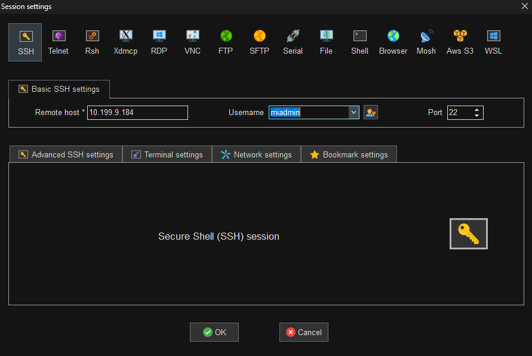

#### 4.2 Crear una sessión SFTP
1. Haz clic nuevamente en **"Session"** y selecciona la pestaña **"SFTP"**.
2. En el campo **"Remote host"**, introduce la IP del servidor.
3. En el campo **"Username"**, introduce el usuario con permisos web (ej. `operadorweb`).
4. Haz clic en **"OK"** e introduce la contraseña cuando el programa lo solicite.
5. Se abrirá una interfaz gráfica con tus carpetas locales a la izquierda y las del servidor a la derecha (directorio inicial `/var/www/html`).

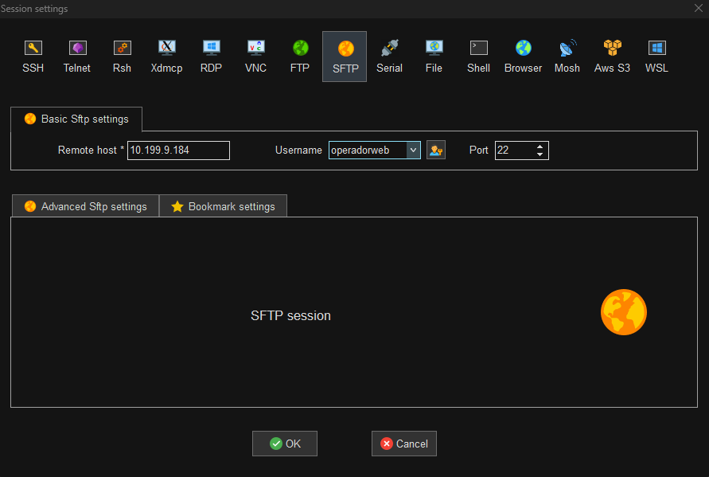

## 5. NetBeans

### 5.1 Instalación y configuración inicial. Plugings.
* El sitio web oficial de descarga es `https://netbeans.apache.org/front/main/index.html`.
* Durante el asistente de instalación, se deben seleccionar las herramientas y tecnologías a utilizar (como Java SE, Java EE, PHP, etc.) y aceptar los términos de la licencia.
* En la configuración inicial, se debe ejecutar Apache NetBeans por primera vez; puede tardar unos segundos mientras carga los módulos internos.
* Si se necesita soporte para otros lenguajes o herramientas, se debe acceder a **Tools > Plugins**.
* En esta configuración específica, se activaron los módulos de **HTML5** y **PHP**.

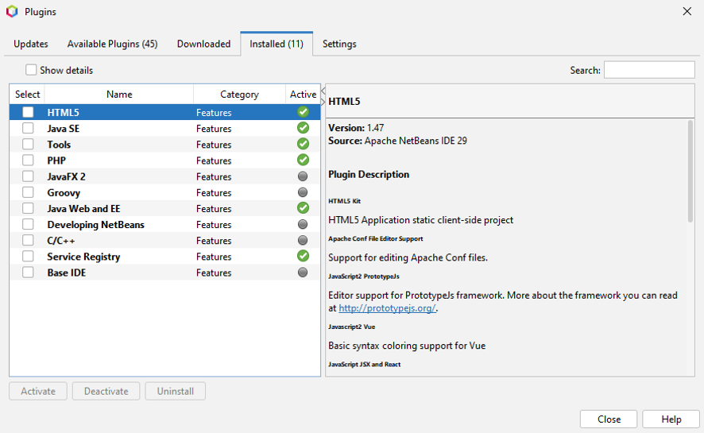

### 5.2 Creación de proyectos, modificación, borrado, prueba.
* **Creación**: Los proyectos se guardarán en el disco de datos, en una carpeta llamada `PROYECTOS-NETBEANS` con la ruta `D:\PROYECTOS-NETBEANS`. Para crear un proyecto nuevo, se hace clic en **File > New Project**, eligiendo la categoría PHP y el tipo "PHP Application". Se le asigna un nombre (ej. `DWESProyectoTema4`) y se indica el directorio local. La configuración base utiliza PHP 8.3 y codificación por defecto UTF-8.

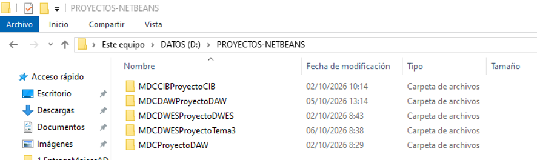

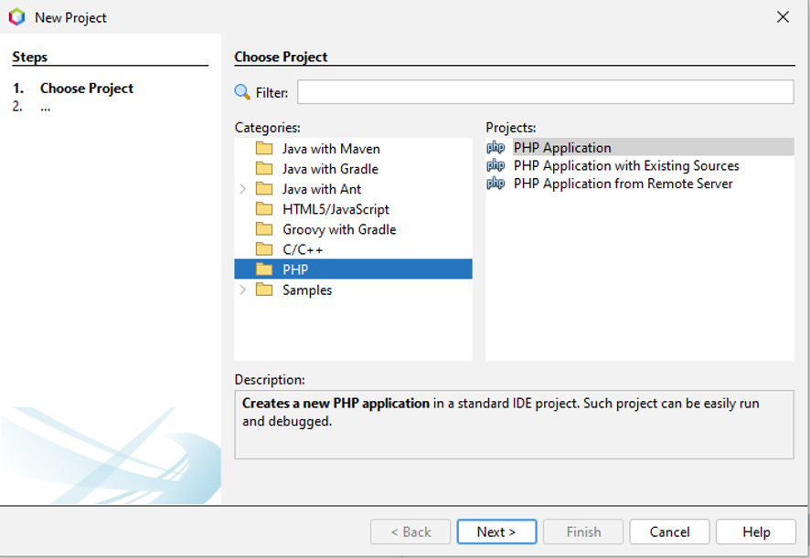

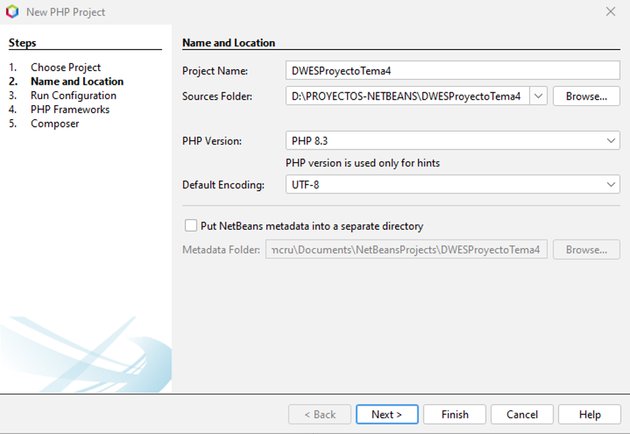

* **Configuración Remota**: En la configuración de ejecución (*Run Configuration*), se elige la opción "Remote Web Site (FTP, SFTP)". Se introduce la URL del proyecto del servidor web (ej. `http://10.199.9.184`), el usuario (`operadorweb`) y el directorio (`/DWESProyectoTema4`).

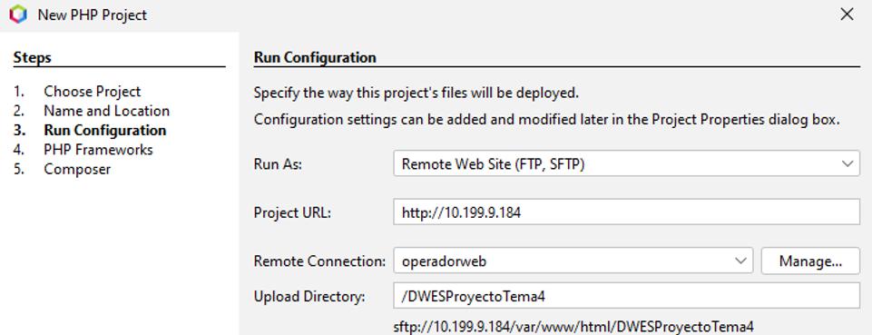

* **Modificación**: En las opciones de subida de archivos (*Upload Files*), se marca **"On Save"**. De esta manera, cada vez que crees o modifiques el código de un archivo y pulses Guardar (`Ctrl + S`), NetBeans se conectará por SFTP y actualizará automáticamente el archivo en el servidor remoto, sin necesidad de subirlos manualmente.

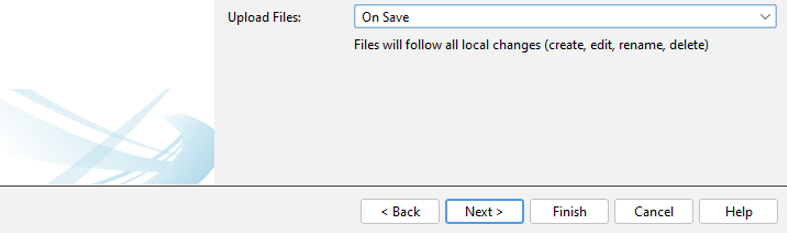

* **Borrado**: Para borrar un archivo o proyecto, basta con hacer clic derecho sobre él en la pestaña *Projects* y seleccionar **Delete**. Al borrar un proyecto completo, NetBeans te preguntará si deseas eliminar únicamente la configuración del IDE o si también quieres eliminar las fuentes locales (*sources*). Al confirmar, y gracias a la sincronización remota, el cambio se reflejará también en el servidor web.

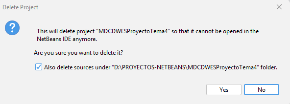

* **Prueba (Testing)**: Para probar tu desarrollo, haz clic derecho sobre el proyecto y selecciona **Run**, o pulsa el icono de reproducción (Play) en la barra superior. Al estar configurado el *Run Configuration* con tu IP, NetBeans abrirá automáticamente Firefox cargando la URL pública de tu servidor (ej. `http://10.199.9.184/MDCDWESProyectoTema4`).

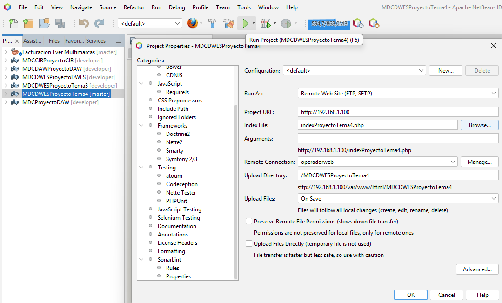

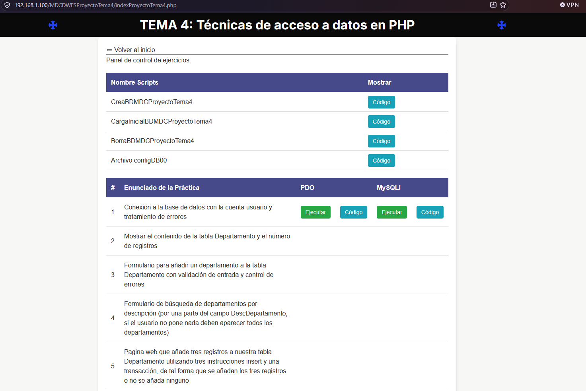

### 5.3 Administración de la base de datos
NetBeans permite administrar de forma remota bases de datos MySQL/MariaDB directamente desde el IDE, facilitando la ejecución de scripts SQL y la visualización de tablas sin necesidad de cambiar a phpMyAdmin o a la consola.

**Pasos para configurar la conexión:**
1. Ve a la pestaña **Services** (Servicios) ubicada en el panel lateral izquierdo junto a la de *Projects*.
2. Despliega el nodo **Databases** (Bases de datos).
3. Haz clic derecho sobre **Databases** y selecciona **New Connection...** (Nueva conexión).

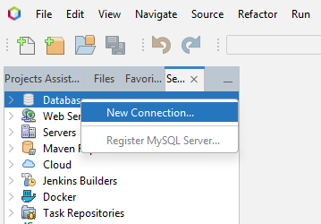

4. En el desplegable de drivers, selecciona **MySQL** o **MariaDB** y haz clic en *Next*. (Previamente descargar el plugin correspondiente a la base de datos).

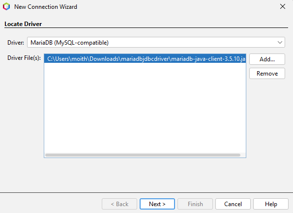

5. Rellena los datos de tu servidor:
   * **Host:** Introduce la IP de tu servidor Ubuntu (ej. `10.199.9.184`).
   * **Port:** `3306` (el puerto por defecto de MariaDB).
   * **Database:** Puedes dejarlo en blanco o poner el nombre de una base específica si ya está creada.
   * **User Name:** El usuario administrador de la base de datos que creaste (ej. `adminsql`).
   * **Password:** La contraseña de ese usuario (ej. `paso`). Marca la casilla "Remember password".

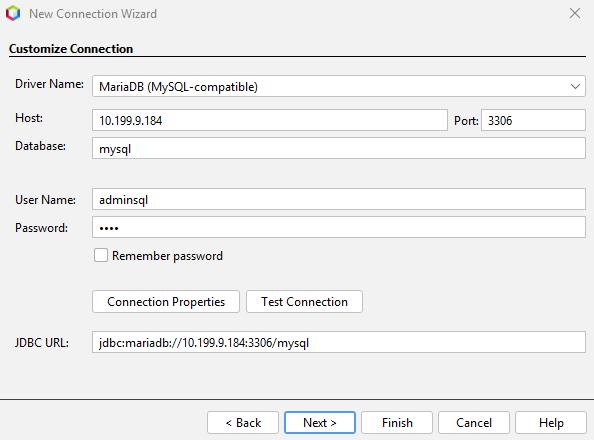

6. Haz clic en el botón **Test Connection**. Si la configuración remota (bind-address en Ubuntu y puertos de UFW) es correcta, aparecerá el mensaje de éxito.
7. Haz clic en **Finish**. A partir de ahora podrás desplegar tu conexión para visualizar las tablas, insertar registros o abrir la ventana del editor SQL haciendo clic derecho > **Execute Command**.

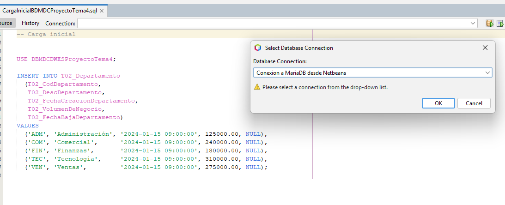

### 5.4 Conexión al repositorio y versionado (Git)
Para llevar un control de versiones adecuado y conectar tu código con repositorios remotos (como GitHub o GitLab), NetBeans incorpora soporte nativo para Git.

**Para inicializar un repositorio local:**
1. Haz clic derecho sobre tu proyecto en la pestaña *Projects*.
2. Selecciona **Versioning** > **Initialize Git Repository...**
3. Confirma la ruta de tu proyecto. Los archivos cambiarán de color indicando su estado en Git (verde para archivos nuevos sin trackear).

**Para clonar un repositorio existente:**
1. En el menú superior, ve a **Team** > **Git** > **Clone...**
2. Introduce la URL del repositorio remoto (ej. `https://github.com/usuario/repositorio.git`).
3. Rellena tu usuario y contraseña (o Token de acceso personal) si es privado.
4. Elige la rama a clonar y el directorio local de destino.

**Operaciones básicas de versionado:**
* **Commit:** Haz clic derecho en el proyecto, ve a **Git** > **Commit...** Escribe el mensaje descriptivo y haz clic en *Commit*.
* **Push (Subir cambios):** Haz clic derecho en el proyecto, ve a **Git** > **Remote** > **Push...** para enviar tus *commits* locales al repositorio remoto.
* **Pull (Bajar cambios):** Ve a **Git** > **Remote** > **Pull...** para descargar las últimas actualizaciones desde el remoto.
* **Ver historial:** Haz clic derecho en un archivo o proyecto y selecciona **Git** > **Show History** para ver la línea de tiempo de los *commits* en la parte inferior del IDE.

### 5.5 Depuración (Configuración de la ejecución para la depuración)

### Configuraciones Adicionales y Herramientas del IDE pendientes
* Depuración (Configuración de la ejecución para la depuración).
* Prueba (Configuración de la ejecución para probar el desarrollo).
* PHP Doc.